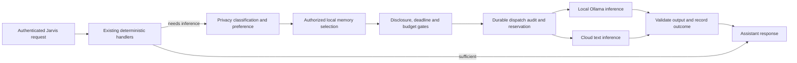

# Jarvis V18: Hybrid Intelligence Router

Status: architecture plan and **offline, source-only proof of concept**. The current
application version is **17.13.0**, not 17.12. This work does not release V18,
replace the Assistant, install a runtime, change a database, or enable paid calls.

## Objective and ownership

Jarvis owns identity, persistent memory, credentials, authorization, tools, budgets,
and execution. Models receive bounded inference requests and return advisory text.
They cannot authorize actions or acquire database, shell, Docker, filesystem, or
network tools. Codex remains the development agent.



The diagram describes the target integration. The current proof exercises the
same policy stages with synthetic memory, injected transports and an in-memory
audit collector. It is not a live Assistant endpoint or a durable spending ledger.

## Repository audit and reuse

| System | Existing implementation | V18 reuse and gap |
| --- | --- | --- |
| Assistant | `apps/web/src/lib/assistant/router.ts`, `serverIntent.ts`, `apps/web/src/app/api/assistant/message/route.ts` | Preserve intent confirmation, status and finance handlers. Remaining chat currently uses OpenClaw. Add the router at the inference boundary after deterministic exits. |
| Intent classification | `resolveAssistantIntent` | With Memory V2 enabled, classification is deterministic. Otherwise an API key can trigger OpenAI **before** message routing. Router activation must disable that early cloud path independently of the memory flag. |
| Model providers | `apps/web/src/lib/operations/reasoning.ts` | Existing OpenAI Responses and loopback Responses adapters bound inputs, disable tools/storage, validate output and expose usage. Native Ollama chat needs an adapter; do not treat a local OpenClaw gateway as proof that inference stays local. |
| Memory | `apps/web/src/lib/memory/policy.ts`, `retrieval.ts`, `evidence.ts`, `context.ts`, `assistant.ts` | Reuse server-created access, owner/domain/label checks before scoring, cache reauthorization and final-context abstention. Preserve labels until cloud disclosure is decided. Current flattened context and global disclosure configuration do not express per-turn consent. |
| Approvals | `apps/web/src/lib/operations/policy.ts`, `engine.ts` | Preserve exact-action digests, expiry, owner entitlement and the sole action `observe.recheck`. No allowlist expansion. |
| Budgets | `OperationsProfile`, `OperationsCostReservation`, `OperationsRun`; `budgetAllows` | Existing transactions lock the profile and reserve before Operations inference. These are tied to Operations runs and do not currently cover Assistant calls or shared per-provider caps. Reuse the ledger lifecycle; do not build a second wallet. |
| Audit | Existing `AuditLog` | Generic `writeAuditLog` is best effort. Disclosure requires a successful, awaited write before transport, ideally in the reservation transaction. Metadata must be field-allowlisted, not just filtered by secret-looking keys. |
| GPU/host metrics | `operations/systemTelemetry.ts`, `gpu.ts`, `/api/operations/system`, existing Operations GPU view | Already exposes utilization, VRAM, temperature and power with fixed, bounded commands. Reuse existing access checks. No new command executor or monitoring service is needed. |
| Other AI traffic | Transcription endpoint, legacy fuzzy intent, memory embedding adapter, Operations reasoning | Inventory these as separate existing paths. A new chat router alone does not govern all AI traffic. Migrate them deliberately after the proof is accepted. |

## Routing policy

1. Prefer deterministic computation when it completely answers the request. Preserve
   the existing memory-insufficient response before inference. The offline proof
   uses bounded two-operand arithmetic as its small deterministic example.
2. Classify the current user message and selected source labels in server code.
   All free text is private by default. Unknown labels fail closed; client-supplied
   labels can never reduce a source's classification.
3. An explicit local, cloud or deterministic preference is strict. `auto` prefers
   local inference for routine work; complex work can use authorized cloud
   inference. Complexity is an advisory routing signal, never authorization.
4. Local model health and exact model availability must pass before dispatch.
   Timeouts and provider failures yield an explicit unavailable result. Only `auto`
   can try another eligible provider, with the same privacy and budget gates.
5. Every cloud request requires a server enablement gate, explicit per-request
   authorization for all transmitted categories, verified price assumptions, a
   user cost ceiling, and an atomic durable reservation. No API-key-presence switch
   may imply consent or spending authorization.
6. Reserve the conservative input/output bound before dispatch. Retain that reserve
   after uncertain failures, timeouts or crashes. Record actual known usage
   separately. Provider overruns must pause further spending pending review.
7. A deadline constrains the whole operation. Record retrieval, routing/health,
   inference and total durations separately; do not present provider time as GPU
   compute time or a client latency preference as a measured provider prediction.

No routing policy currently has measured reasoning-quality scores. Task complexity
is explicit in the proof. A future server classifier and task-specific evaluations
must establish quality thresholds before automated quality-based routing is claimed.

## Privacy and security

- Retrieve locally under the authenticated owner's existing `Access`; never accept
  `userId`, agent grants, memory ownership or provider endpoints as browser authority.
- Keep PostgreSQL records and vectors in Jarvis. Cloud inference receives only the
  current request and a bounded selection of authorized excerpts, not full history,
  database handles, record IDs, host credentials or raw source objects.
- For the proof, secret-bearing input/excerpts are rejected and common direct
  identifiers are redacted before cloud transport. Regex detection is conservative
  defense in depth, not exhaustive DLP. Redaction does not downgrade a category or
  remove the need for sensitive disclosure consent.
- Consent must be bound to the authenticated request, provider and displayed
  categories in the future API/UI. Retrieval permission is distinct from permission
  to transmit data. The proof's consent object is a trusted server input, not a
  browser authentication mechanism.
- Configure local inference only on numeric loopback addresses. Reject URL userinfo,
  queries, fragments, unexpected paths and redirects. Never expose the Ollama
  endpoint directly to models or unauthenticated clients. A loopback daemon can still
  proxy cloud inference: verify its cloud features, selected model and outbound
  network policy before live activation. Known cloud model aliases are rejected by
  the proof's adapter, but that check alone does not establish local execution.
- Do not attach tools. Validate response shapes and reject tool-call output. Text
  resembling an action remains untrusted text; it does not enter Operations execution.
- Audit categories, routing reason, outcome, timings and usage estimates. Never log
  prompts, excerpts, responses, keys, headers, raw provider errors or GPU process paths
  in router telemetry. Existing conversation storage remains local and separate.
- Abort on dispatch-audit failure. An inference result is not successful until its
  outcome is recorded. Audit persistence outages must be visible, not silently ignored.
- Memory retrieval itself can invoke an embedding provider. Live integration must
  restrict this path to configured local embeddings or full-text retrieval; changing
  only the final text provider would leave an earlier disclosure path open.

## Smallest proof of concept

New source modules are intentionally dependency-injected and have no default live
transport or database client:

| File | Responsibility |
| --- | --- |
| `apps/web/src/lib/intelligence/router.ts` | Classify, minimize context, select route, enforce disclosure/deadline/reservation gates, invoke inference and emit bounded audit events. |
| `apps/web/src/lib/intelligence/providers.ts` | Ollama-compatible `/api/chat` and existing-provider OpenAI `/v1/responses` contracts; explicit injected HTTP transport, bounded responses, no tools. |
| `apps/web/src/lib/intelligence/budget.ts` | Reuse Operations `budgetAllows` for global and per-provider caps. A policy predicate, **not** a durable reservation implementation. |
| Matching `*.test.ts` | Policy, privacy, provider, budget and authorization-boundary tests with synthetic data and transport fixtures. |
| `apps/web/scripts/intelligence-poc.mjs` | Executable request → classification → routing → simulated inference → response → audit demonstration. Refuses live execution; does not read credentials or environment files. |
| `apps/web/package.json` | Focused test and offline demonstration commands; include new tests in the existing suite. |

The provider factories require an explicitly supplied transport. The demonstration
supplies only synthetic transports. There is no application caller, feature switch
or default `fetch` that activates these new providers. This is deliberate: real
spending and durable audit adapters are prerequisites for wiring the Assistant.
OpenAI health reports configuration readiness only; it does not make a request or
verify connectivity, model availability or account access. Ollama health checks the
configured model name against the daemon's model list without pulling/loading it.

Adapter contracts follow the official [Ollama chat API](https://docs.ollama.com/api/chat),
[Ollama model-list API](https://docs.ollama.com/api/tags), and
[OpenAI Responses guide](https://developers.openai.com/api/docs/guides/migrate-to-responses?api-mode=responses),
alongside the repository's existing Operations reasoning adapter.

## Implementation phases and proposed integration changes

**Phase 1 — this source-only proof.** Audit the current architecture, implement the
policy and bounded providers, and exercise all three routes offline. Preserve all
existing Assistant behavior and Operations execution. No schema changes.

**Phase 2 — reviewable Assistant integration.** Add an off-by-default server gate
and adapt `assistant/message/route.ts` and `assistant/serverIntent.ts` so deterministic
handlers precede every inference path. Add a server memory adapter that preserves
labels/provenance and rechecks evidence after clipping. Add per-request cloud
disclosure preferences and explicit consent to the Assistant UI. Fail closed rather
than fall through to legacy OpenClaw when the enabled router denies a request.

Before paid activation, refactor the existing Operations reservation transaction into
a shared helper used by both Operations and Assistant. Propose a separately reviewed
additive migration to identify request kind/provider and enforce reservation
idempotency; preserve existing run/attempt semantics and global profile locking.
Maintain per-user global and per-provider daily/monthly totals, reserve across
concurrent workers, keep uncertain charges, and pause on usage overruns. Verify with
disposable PostgreSQL concurrency/crash tests. Do not insert synthetic Operations
runs or pretend the current ledger already accounts for Assistant traffic.

**Phase 3 — approved local runtime validation.** A read-only hardware check identified
an **NVIDIA GeForce RTX 3070 with 8,192 MiB VRAM**, driver 535.309.01. This establishes
hardware inventory only; no local model was loaded or GPU inference tested. Present
the exact model, model size/license,
VRAM requirements, endpoint binding, service definition, storage path and resource
limits for approval before downloads, installation or service operations. Validate
model health, load behavior, local embeddings, GPU utilization and deadline behavior
against an isolated runtime. No hardware purchase recommendation is needed now.

**Phase 4 — approved cloud validation and gradual adoption.** Present the selected
provider/model, current verified pricing, maximum test spend, categories of synthetic
data, and rollback before any paid call. Prove that budget/audit outages and local
failure cannot cause unauthorized cloud disclosure. Migrate remaining inference
callers one at a time, and keep action execution in Operations.

## Evaluation and observability

Carry forward the [Memory V2.2 evaluation](./memory-engine-v2-2.md): answerability,
precision/recall, source correctness, explicit unknowns and retrieval stage timings.
Add paired deterministic/local/cloud task fixtures, separately graded for correct
answers, grounding and inappropriate action claims. Do not use response speed or
model self-confidence as reasoning quality.

Track route distribution, denial reason, availability/failures, p50/p95 by phase,
token usage, reserved/observed cost by provider, source correctness, and task outcome.
Join bounded GPU utilization/VRAM/power observations from the existing telemetry.
Model-inference milliseconds do not prove GPU execution. Existing Operations outcomes
continue to represent proposed-action verification; text generation does not prove an
action succeeded.

## Validation and approval boundary

Run source checks in an isolated source copy with existing dependencies and **without
production environment files**. Commands from `apps/web`:

```bash
npm run test:intelligence
npm run intelligence:poc
npm test
npm run lint
npx tsc --noEmit --incremental false
npm run version:check
git diff --check
```

No dependency installation, live provider call, database migration, production build
output overwrite, new service, deployment or release is part of this phase. Runtime
HTTP/browser and database-concurrency checks belong to Phase 2, when an actual API and
durable adapter exist. Offline fixtures cannot establish live model quality, GPU
performance, provider availability or production authorization end to end.

Approval is required before infrastructure changes or paid calls because the user
explicitly required a presented plan and approval for those actions. Future approval
must identify the concrete runtime configuration or bounded paid validation, rather
than authorize unrestricted infrastructure or model spending.

## Recorded source verification

The isolated final source passed **168 unit/regression tests**, including **43 new
intelligence tests** (26 router, 12 provider, 5 budget), plus ESLint, TypeScript and
version consistency. All **7 offline scenarios** passed: deterministic arithmetic,
local inference, authorized cloud inference, privacy denial, budget exhaustion,
missing-evidence abstention and unavailable local model. Live provider calls and
database connections were both **zero**.

See the [synthetic proof output](./evaluations/intelligence-v18-offline/proof.json)
and [verification/source hashes](./evaluations/intelligence-v18-offline/verification.json).
The proof's audit records are in-memory fixtures serialized into that artifact;
they do not establish database durability. `estimatedUsd` is the conservative
reserved bound, including uncertain attempts, not a provider invoice. A timed-out
reservation may complete later and must remain charged; no automatic paid retry is
sent. Model output quality and shared-ledger concurrency remain unverified.

No application route, production configuration, database schema or Operations
execution policy was changed by this phase. Earlier Memory V2.2 work remains
preserved in the working tree, and its temporary evaluation services were closed.
